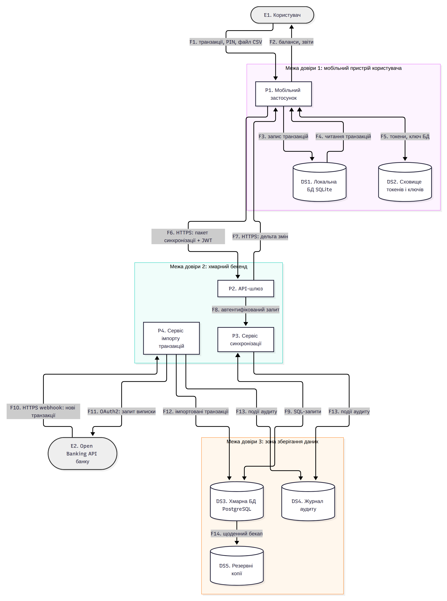
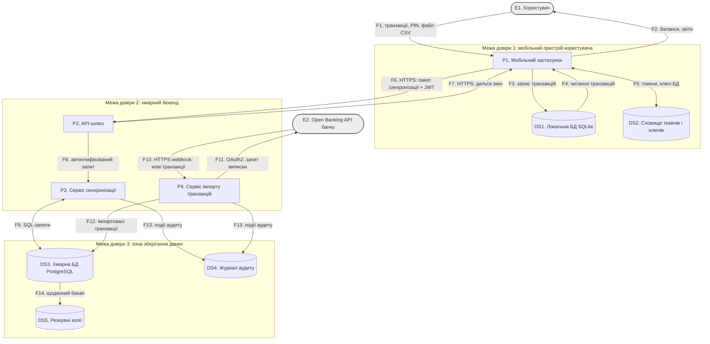

# Модель загроз: мобільний застосунок обліку особистих фінансів «FinTrack»

**Варіант:** 29  ·  **Здобувач:** Шульга Нікіта Сергійович  ·  **Група:** ІП-33

**Пріоритетна категорія STRIDE:** підміна даних (Tampering)

## 1. Опис системи та активи

Об’єкт моделювання — вигадана навчальна система FinTrack: мобільний застосунок обліку особистих фінансів для Android та iOS із хмарною синхронізацією. Користувач вручну вносить доходи й витрати, розподіляє їх за категоріями, веде бюджети (зокрема спільний сімейний бюджет кількох облікових записів) і переглядає звіти. Транзакції можна також імпортувати автоматично з банку через Open Banking API або з файла виписки у форматі CSV.

Застосунок працює за принципом offline-first: усі записи спочатку зберігаються в локальній базі даних на пристрої, а потім пакетами синхронізуються з хмарним бекендом через HTTPS REST API з автентифікацією за JWT. Бекенд складається з API-шлюзу, сервісу синхронізації та сервісу імпорту банківських транзакцій, який отримує від банку webhook-сповіщення про нові операції. Дані зберігаються в PostgreSQL, події безпеки — в окремому журналі аудиту, щоденні дампи БД — в об’єктному сховищі резервних копій.

Користувачі: власник облікового запису; учасники спільного бюджету; адміністратор бекенду (обслуговування, без доступу до бізнес-функцій). Зовнішні служби: Open Banking API банку-партнера; магазини застосунків (канал поширення). Застосунок не ініціює платежів — він лише обліковує операції, тому головна цінність системи — достовірність фінансової історії та її конфіденційність. Усі дані в моделі синтетичні.

Шкала цінності: В — висока, С — середня, Н — низька.

| Актив | Тип | Цінність (К/Ц/Д) |
|---|---|---|
| A1. Історія фінансових транзакцій і баланси рахунків | дані (DS1, DS3) | В/В/С |
| A2. Облікові дані користувачів (хеші паролів, PIN) | дані автентифікації | В/В/С |
| A3. Токени доступу (JWT, refresh-токени, OAuth2-токени Open Banking) | секрети сесії | В/В/С |
| A4. Криптографічні ключі (ключ шифрування локальної БД, секрет підпису webhook) | секрети | В/В/С |
| A5. Журнал аудиту дій користувачів і сервісів | журнал подій | С/В/С |
| A6. Резервні копії хмарної БД | дані | В/В/С |
| A7. Цілісність коду мобільного застосунку (APK/IPA) | програмне забезпечення | Н/В/С |
| A8. Доступність сервісу синхронізації | послуга | Н/С/С |

## 2. Діаграма потоків даних





Потоки, що перетинають межі довіри:

| Потоки | Елементи | Межа |
|---|---|---|
| F1, F2 | E1 ↔ P1 | зовнішня сутність → МД1 |
| F6, F7 | P1 ↔ P2 | МД1 → МД2 (через інтернет) |
| F9, F12, F13 | P3, P4 → DS3, DS4 | МД2 → МД3 |
| F10, F11 | E2 ↔ P4 | зовнішня сутність → МД2 |

## 3. Загрози за STRIDE

| № | Елемент/потік | Категорія STRIDE | Опис загрози | Порушувана властивість |
|---|---|---|---|---|
| T-01 | F6/F7 (P1 ↔ P2) | Tampering | Модифікація пакета синхронізації в транзиті: зловмисник у тій самій Wi-Fi-мережі виконує атаку «людина посередині»; застосунок довіряє сертифікатам центрів сертифікації, встановленим користувачем, і не використовує certificate pinning, тому суми й категорії транзакцій змінюються до надходження на сервер. | цілісність |
| T-02 | DS1 Локальна БД SQLite | Tampering | Пряма зміна нешифрованого файла SQLite на рутованому пристрої або через резервну копію ADB (android:allowBackup="true"): змінюються суми, дати й баланси; змінені записи синхронізуються в хмару як легітимні. | цілісність |
| T-03 | P3 Сервіс синхронізації (F8) | Tampering | Масове присвоєння полів (mass assignment): сервіс зберігає об’єкт транзакції з пакета «як є», зокрема поля balance_after, owner_id і created_at; модифікований клієнт перезаписує обчислений баланс рахунку й дату операції. | цілісність |
| T-04 | F10 (E2 → P4) | Tampering | Підроблені webhook-сповіщення: ендпоінт /webhooks/bank приймає повідомлення про нові транзакції без перевірки HMAC-підпису та позначки часу; будь-хто, кому відома адреса ендпоінта, вносить фіктивні транзакції в історію користувача. | цілісність |
| T-05 | F9 (P3 → DS3) | Tampering | SQL-ін’єкція в параметрах фільтра пошуку транзакцій (q, sort): рядок конкатенується в SQL-запит, що дозволяє виконати UPDATE/DELETE над записами будь-яких користувачів у DS3. | цілісність (також конфіденційність, доступність) |
| T-06 | P1 Мобільний застосунок | Tampering | Репакування застосунку: модифікований APK з неофіційного джерела містить вбудований код, що змінює суми в пакетах синхронізації та пересилає токени зловмисникові; сервер не перевіряє цілісність клієнта. | цілісність |
| T-07 | DS4 Журнал аудиту | Tampering | Обліковий запис сервісів має права UPDATE/DELETE на таблицю аудиту; зловмисник, що отримав доступ до P3, видаляє або змінює записи про свої дії й приховує підміну даних. | цілісність (неспростовність) |
| T-08 | F6 (P1 → P2) | Tampering | Повторне відтворення (replay) перехопленого чи збереженого пакета синхронізації: без ідентифікаторів змін і контролю версій це дублює транзакції або відкочує баланс до попереднього стану. | цілісність |
| S-09 | E1 Користувач (вхід через P2) | Spoofing | Credential stuffing: перебір пар «логін — пароль» з чужих витоків на ендпоінті /auth/login без обмеження частоти спроб і другого фактора; зловмисник видає себе за власника облікового запису. | автентичність |
| S-10 | E1 / P1 (локальний вхід) | Spoofing | Обхід локальної автентифікації на викраденому пристрої: 4-значний PIN без обмеження кількості спроб дозволяє сторонній особі відкрити застосунок від імені власника. | автентичність |
| R-11 | E1 Користувач (спільний бюджет) | Repudiation | Учасник спільного бюджету заперечує видалення чи зміну витрати: зміни фіксуються без прив’язки до автора й пристрою, тому неможливо довести, хто виконав дію. | неспростовність |
| I-12 | DS2 Сховище токенів і ключів | Information disclosure | Refresh-токен і ключ шифрування БД зберігаються в SharedPreferences у відкритому вигляді й потрапляють у системний журнал (logcat); застосунок із root-доступом або резервна копія пристрою розкривають їх. | конфіденційність |
| I-13 | DS5 Резервні копії | Information disclosure | Помилка конфігурації об’єктного сховища: бакет із щоденними дампами DS3 доступний за публічним посиланням — витік повної фінансової історії всіх користувачів. | конфіденційність |
| D-14 | P2 API-шлюз | Denial of service | Надсилання пакетів синхронізації з десятками тисяч транзакцій без обмеження розміру тіла запиту й частоти: вичерпання CPU та пам’яті сервісу P3, недоступність синхронізації. | доступність |
| E-15 | P3 Сервіс синхронізації | Elevation of privilege | IDOR: маршрут /accounts/{account_id}/transactions перевіряє лише дійсність JWT, але не належність рахунку; підстановка чужого account_id дає читання й зміну чужих транзакцій (горизонтальне підвищення привілеїв). | авторизація |

Розподіл: Tampering — 8, Spoofing — 2, Information disclosure — 2, Repudiation — 1, Denial of service — 1, Elevation of privilege — 1.

## 4. Оцінювання ризиків (CVSS / матриця)

Ранг ризику = ймовірність × вплив (В = 3, С = 2, Н = 1): 9 — критичний, 6 — високий, 3–4 — середній, 1–2 — низький. **Жирним** позначено загрози високого ризику (CVSS ≥ 7,0).

| № загрози | Вектор CVSS | Базова оцінка | Імовірність | Вплив | Ранг ризику |
|---|---|---|---|---|---|
| T-01 | `CVSS:3.1/AV:A/AC:H/PR:N/UI:N/S:U/C:H/I:H/A:N` | 6.8 (середній) | Н | В | середній |
| T-02 | `CVSS:3.1/AV:L/AC:L/PR:L/UI:N/S:U/C:N/I:H/A:N` | 5.5 (середній) | Н | В | середній |
| T-03 | `CVSS:3.1/AV:N/AC:L/PR:L/UI:N/S:U/C:N/I:H/A:N` | 6.5 (середній) | С | С | середній |
| **T-04** | `CVSS:3.1/AV:N/AC:L/PR:N/UI:N/S:U/C:N/I:H/A:N` | **7.5** (високий) | С | В | високий |
| **T-05** | `CVSS:3.1/AV:N/AC:L/PR:L/UI:N/S:U/C:H/I:H/A:H` | **8.8** (високий) | С | В | високий |
| **T-06** | `CVSS:3.1/AV:N/AC:L/PR:N/UI:R/S:U/C:H/I:H/A:N` | **8.1** (високий) | С | В | високий |
| T-07 | `CVSS:3.1/AV:N/AC:L/PR:H/UI:N/S:U/C:N/I:H/A:N` | 4.9 (середній) | Н | С | низький |
| T-08 | `CVSS:3.1/AV:N/AC:H/PR:L/UI:N/S:U/C:N/I:H/A:N` | 5.3 (середній) | Н | С | низький |
| **S-09** | `CVSS:3.1/AV:N/AC:H/PR:N/UI:N/S:U/C:H/I:H/A:N` | **7.4** (високий) | С | В | високий |
| S-10 | `CVSS:3.1/AV:P/AC:L/PR:N/UI:N/S:U/C:H/I:H/A:N` | 6.1 (середній) | Н | С | низький |
| R-11 | `CVSS:3.1/AV:N/AC:L/PR:L/UI:N/S:U/C:N/I:L/A:N` | 4.3 (середній) | С | Н | низький |
| I-12 | `CVSS:3.1/AV:L/AC:L/PR:L/UI:N/S:U/C:H/I:N/A:N` | 5.5 (середній) | Н | В | середній |
| **I-13** | `CVSS:3.1/AV:N/AC:L/PR:N/UI:N/S:U/C:H/I:N/A:N` | **7.5** (високий) | С | В | високий |
| D-14 | `CVSS:3.1/AV:N/AC:L/PR:L/UI:N/S:U/C:N/I:N/A:H` | 6.5 (середній) | С | С | середній |
| **E-15** | `CVSS:3.1/AV:N/AC:L/PR:L/UI:N/S:U/C:H/I:H/A:N` | **8.1** (високий) | С | В | високий |

Загроз високого ризику: 6 (T-04, T-05, T-06, S-09, I-13, E-15). Оцінки обчислено `lab01_threat_model/scoring.py`.

## 5. Реєстр ризиків і рішення

| № | Ризик | Рішення (усунути/зменшити/передати/прийняти) | Контрзахід | Залишковий ризик |
|---|---|---|---|---|
| T-05 | Зміна записів будь-яких користувачів через SQL-ін’єкцію | усунути | Параметризовані запити (ORM), allowlist допустимих значень для sort; Row-Level Security у PostgreSQL за owner_id (КЗ-2); роль БД без прав DDL; SAST-перевірка в CI. | низький |
| T-06 | Підміна даних модифікованим клієнтом | зменшити + передати | Атестація клієнта (Play Integrity API / App Attest): сервер відхиляє запити неоригінальних збірок; обфускація R8; поширення лише через офіційні магазини (частину ризику передано модерації магазинів); серверна валідація всіх даних (КЗ-1). | середній — повністю виключити репакування неможливо, але КЗ-1 обмежує шкоду |
| E-15 | Читання й зміна чужих рахунків (IDOR) | усунути | Централізована перевірка належності ресурсу в P3: owner_id рахунку має збігатися з суб’єктом JWT (КЗ-1); RLS у DS3 як другий рубіж (КЗ-2). | низький |
| T-04 | Фіктивні транзакції через підроблений webhook | усунути | Перевірка HMAC-SHA256 підпису зі спільним секретом, вікно часу ±5 хв, ідемпотентність за event_id; webhook — лише тригер, дані транзакції P4 повторно запитує в банку через F11. | низький |
| I-13 | Витік резервних копій | усунути | Блокування публічного доступу на рівні облікового запису хмари, шифрування SSE-KMS, сканування IaC-конфігурації в CI. | низький |
| S-09 | Захоплення облікового запису | зменшити | Обмеження частоти спроб за обліковим записом та IP, 2FA (TOTP), перевірка пароля за базою зламаних паролів, сповіщення про вхід з нового пристрою. | низький |
| T-01 | Зміна пакета синхронізації в транзиті | зменшити | TLS 1.3, certificate pinning (SPKI) у network_security_config, заборона користувацьких CA для домену API. | низький |
| T-03 | Перезапис службових полів через mass assignment | усунути | Серверні DTO з allowlist полів; owner_id береться лише з JWT; balance_after обчислює сервер (КЗ-1). | низький |
| D-14 | Відмова сервісу синхронізації | передати + зменшити | Захист від DDoS на рівні CDN/WAF провайдера (передача ризику); ліміт тіла запиту 1 МБ і 500 транзакцій у пакеті; rate limit на користувача. | низький |
| T-02 | Зміна локальної БД на пристрої | зменшити | Шифрування БД SQLCipher із ключем в апаратному Keystore/Keychain, allowBackup=false; сервер перераховує баланси з транзакцій і не довіряє клієнтським підсумкам (КЗ-1). | низький |
| I-12 | Розкриття токенів і ключів на пристрої | усунути | Зберігання в EncryptedSharedPreferences/Keychain, заборона логування токенів (lint-правило), access-токен на 15 хв із ротацією refresh-токена. | низький |
| T-08 | Replay пакета синхронізації | усунути | UUID кожної зміни (ідемпотентність), версія запису з оптимістичним блокуванням, відхилення пакетів із застарілою версією. | низький |
| T-07 | Знищення слідів у журналі аудиту | зменшити | Окрема роль лише з правом INSERT; хеш-ланцюг записів (кожен містить SHA-256 попереднього); щоденний експорт у WORM-сховище. | низький |
| S-10 | Вхід у застосунок на викраденому пристрої | прийняти | Обґрунтування: потрібне фізичне заволодіння розблокованим пристроєм; застосунок не виконує платежів, тож збитки обмежені переглядом; блокування екрана ОС уже діє. Дешеві доповнення (6-значний PIN, затримка після 5 спроб) — у плані наступного релізу. | низький |
| R-11 | Заперечення змін у спільному бюджеті | зменшити | Журнал змін спільного бюджету з author_id, device_id і позначкою часу в DS4; історія версій запису доступна всім учасникам. | низький |

Наскрізні контрзаходи:

| Код | Контрзахід | Суть | Загрози |
|---|---|---|---|
| КЗ-1 | Сервер — єдине джерело істини | серверна валідація схеми з allowlist полів, owner_id лише з JWT, перерахунок балансів на сервері, перевірка належності ресурсу | T-02, T-03, T-06, E-15 |
| КЗ-2 | Row-Level Security у PostgreSQL | політика owner_id = current_setting('app.user_id') на всіх таблицях з даними користувачів; навіть успішна ін’єкція чи IDOR не виходить за межі власних рядків | T-03, T-05, E-15 |

## 6. Дерево атак для найкритичнішої загрози

```
Мета: несанкціоновано змінити фінансові записи інших
      користувачів у хмарній БД DS3 (T-05, CVSS 8.8)
  AND
  ├── 1. Отримати автентифікований доступ до API (PR:L)
  │     OR
  │     ├── 1.1 Зареєструвати власний обліковий запис (безкоштовно)
  │     ├── 1.2 Використати викрадений refresh-токен (I-12)
  │     └── 1.3 Підібрати пароль чужого облікового запису (S-09)
  └── 2. Виконати довільний SQL через сервіс синхронізації P3
        OR
        ├── 2.1 Ін’єкція першого порядку в параметр пошуку
        │     AND
        │     ├── 2.1.1 Виявити параметр (q або sort), що конкатенується в SQL
        │     ├── 2.1.2 Визначити СКБД за текстом помилки у відповіді API
        │     └── 2.1.3 Надіслати UPDATE через stacked query без WHERE owner_id
        └── 2.2 Ін’єкція другого порядку через пакет синхронізації
              AND
              ├── 2.2.1 Записати назву категорії зі шкідливим рядком
              │         модифікованим клієнтом (T-06, T-03)
              └── 2.2.2 Запустити формування звіту, що вставляє назву
                        категорії в динамічний SQL
```

Перекриття гілок контрзаходами:

| Гілка | Контрзахід | Загроза в реєстрі |
|---|---|---|
| 1.1 | не перекривається (реєстрація відкрита за задумом) | — |
| 1.2 | зберігання токенів у Keystore, короткий TTL | I-12 |
| 1.3 | rate limit, 2FA, перевірка зламаних паролів | S-09 |
| 2.1.1–2.1.3 | параметризовані запити, allowlist для sort | T-05 |
| 2.1.2 | узагальнені повідомлення про помилки | T-05 |
| 2.2.1 | атестація клієнта, серверна валідація (КЗ-1) | T-06, T-03 |
| 2.2.2 | параметризовані запити в генераторі звітів | T-05 |
| усе дерево | RLS у PostgreSQL (КЗ-2): навіть успішний SQL не змінює чужі рядки | T-05, E-15 |

## 7. Висновки

**Розподіл загроз за категоріями STRIDE.** Із 15 загроз 8 (53 %) належать до категорії Tampering, по 2 — до Spoofing та Information disclosure, по 1 — до Repudiation, Denial of service і Elevation of privilege. Гіпотезу варіанта підтверджено: підміна даних домінує і за кількістю, і за вагою — 3 з 6 загроз високого ризику (T-04, T-05, T-06) та загроза з найвищою оцінкою (T-05, 8.8) належать до Tampering. Причина — архітектурна: фінансові записи створюються на пристрої (МД1), який повністю контролює користувач чи зловмисник, і проходять через дві межі довіри, а ще одне джерело даних (webhook банку) входить у бекенд ззовні. Головний актив A1 має високу цінність саме за цілісністю: застосунок не виконує платежів, тому вартість атаки полягає у спотворенні фінансової картини.

**Найвразливіші елементи діаграми.** Найбільше загроз породив сервіс синхронізації P3 разом з його потоками F8 і F9: T-03, T-05, E-15 (усі три — високого або середнього ризику з I:H). Це перший довірений компонент, що приймає дані з недовіреної МД1, тож усі недоліки валідації концентруються в ньому. Друге місце посідає мобільний пристрій (МД1): P1, DS1, DS2 дали T-02, T-06, S-10, I-12, але ці загрози здебільшого вимагають локального чи фізичного доступу (AV:L/P), тому мають нижчі оцінки. Потоки F6/F7 і F10, що перетинають межі МД1→МД2 та «зовнішня сутність»→МД2, дали T-01, T-08 і T-04. Отже, 9 з 15 загроз прив’язано до елементів на межах довіри або безпосередньо за ними.

**Чому T-05 має найвищу оцінку.** Для вектора AV:N/AC:L/PR:L/UI:N/S:U/C:H/I:H/A:H підоцінка експлуатованості дорівнює 8,22 · 0,85 · 0,77 · 0,62 · 0,85 ≈ 2,84, підоцінка впливу — 6,42 · (1 − 0,44³) ≈ 5,87, сума 8,71 після округлення вгору дає 8,8. Найбільший внесок дає вплив: SQL-ін’єкція порушує одразу всі три властивості (C, I, A = H), тоді як E-15 (8,1) не зачіпає доступність, а T-04 (7,5) — лише цілісність. Метрика AV:N (атака через інтернет) і PR:L (достатньо безкоштовної реєстрації) майже не знижують експлуатованість.

**Контрзахід із найбільшим покриттям.** Корінь дерева атак — вузол AND, тому параметризовані запити, що закривають гілку 2 (обидва варіанти ін’єкції), зупиняють атаку повністю, хоча гілку 1 перекрити неможливо (реєстрація відкрита). Найширше покриття в реєстрі дають наскрізні контрзаходи: КЗ-1 «сервер — єдине джерело істини» знижує ризик T-02, T-03, T-06 і E-15, а КЗ-2 (Row-Level Security) — T-03, T-05 і E-15 та обмежує наслідки будь-якої гілки дерева. Вони ефективніші за точкові заходи, бо діють на рівні довіреного компонента незалежно від того, як саме дані було підмінено на клієнті.

**Прийняті ризики.** Стратегію «прийняти» обрано лише для S-10 (6,1, ранг низький). Для повного усунення потрібен апаратно захищений окремий вхід із біометрією класу STRONG і віддаленим стиранням — це суттєві витрати на розроблення й підтримку, тоді як атака вимагає фізичного заволодіння розблокованим пристроєм, а збитки обмежені переглядом даних, бо застосунок не виконує платежів. Ризики D-14 і частково T-06 передано провайдерам (CDN/WAF, магазини застосунків), де захист дешевший завдяки масштабу.

1. Для мобільного застосунку обліку особистих фінансів FinTrack побудовано модель загроз: визначено 8 активів, DFD з 11 елементами, 14 потоками та 3 межами довіри, виявлено 15 загроз, з яких 8 належать до пріоритетної категорії Tampering.
2. Шість загроз мають базову оцінку CVSS ≥ 7,0 (T-05 — 8,8; T-06 і E-15 — 8,1; T-04 та I-13 — 7,5; S-09 — 7,4), що вдвічі перевищує мінімальну вимогу (3). Найкритичніша — SQL-ін’єкція в сервісі синхронізації T-05: віддалена атака з мінімальними привілеями, що порушує всі три властивості безпеки головного активу A1.
3. Першочергово слід усунути загрози T-05, E-15, T-03 і T-04 у бекенді: вони мають мережевий вектор, низьку складність і можуть бути закриті програмними змінами без участі користувача. Загрози на пристрої (T-02, I-12, S-10) мають нижчі оцінки через потребу в локальному чи фізичному доступі.
4. Найбільший ефект за найменших витрат дадуть два наскрізні контрзаходи: серверна валідація з перерахунком балансів (КЗ-1) і Row-Level Security у PostgreSQL (КЗ-2). Разом вони знижують ризик п’яти загроз (T-02, T-03, T-05, T-06, E-15) і перекривають усі гілки дерева атак. Після впровадження реєстру контрзаходів лише T-06 зберігає середній залишковий ризик, решта — низький.
